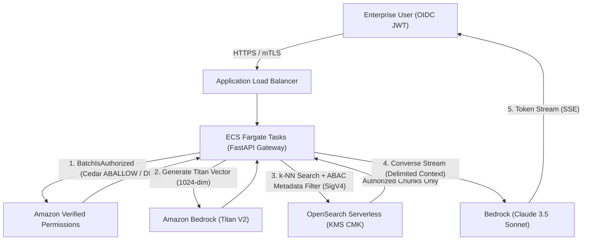

# Zero-Trust Enterprise RAG Gateway on AWS
[](https://aws.amazon.com)
[](https://aws.amazon.com/bedrock/)
[](https://opensearch.org)
[](https://www.cedarpolicy.com)
[](https://www.terraform.io)

> Production-grade technical implementation and reference architecture for stopping multi-tenant Generative AI data leaks using **Amazon Verified Permissions (Cedar ABAC)**, **Amazon OpenSearch Serverless**, and **Amazon Bedrock**.

---

##  Architecture Overview



---

## Repository Structure

```
zero-trust-rag-gateway/
├── terraform/
│   ├── versions.tf              # Provider constraints (AWS ~> 5.50)
│   ├── network.tf               # Multi-AZ VPC, private subnets, NAT Gateway
│   ├── kms.tf                   # Customer Managed Key with annual rotation
│   ├── opensearch.tf            # Serverless vector collection & PrivateLink policies
│   ├── verified_permissions.tf  # Cedar policy store with STRICT validation
│   └── ecs_fargate.tf           # Task definitions, roles, and security groups
├── policies/
│   ├── schema.json              # Cedar entity and action schema definition
│   └── rag_gateway_policy.cedar # Cedar ABAC multi-tenant isolation policies
├── app/
│   ├── main.py                  # FastAPI server with SSE token streaming
│   ├── config.py                # Environment-driven settings
│   ├── cedar_auth.py            # Amazon Verified Permissions client
│   ├── opensearch_client.py     # SigV4 signed k-NN boolean search client
│   ├── bedrock_client.py        # Titan embeddings & Converse API with fallback
│   └── requirements.txt         # Pinned production Python dependencies
├── tests/
│   └── test_rag.py              # Pytest automated test suite
├── monitoring/
│   └── otel-collector-config.yaml # AWS Distro for OpenTelemetry pipeline
├── .github/workflows/
│   └── deploy.yml               # GitHub Actions CI/CD using AWS IAM OIDC
└── Dockerfile                   # Hardened multi-stage non-root container
```

---

##  Quickstart Deployment

### 1. Prerequisites
- **AWS CLI v2** configured with target account credentials in `us-east-1` or `us-west-2`.
- **Terraform >= 1.7.0**
- **Python 3.11+**
- **Docker Engine**
- Bedrock Model Access enabled for:
  - `anthropic.claude-3-5-sonnet-20240620-v1:0`
  - `anthropic.claude-3-haiku-20240307-v1:0`
  - `amazon.titan-embed-text-v2:0`

### 2. Deploy Infrastructure with Terraform
```bash
cd terraform
terraform init
terraform plan
terraform apply -auto-approve
```

### 3. Run Gateway Service Locally
```bash
cd ../app
pip install -r requirements.txt
export POLICY_STORE_ID="<OUTPUT_FROM_TERRAFORM>"
export OPENSEARCH_ENDPOINT="<OUTPUT_FROM_TERRAFORM>"
uvicorn app.main:app --host 0.0.0.0 --port 8000
```

### 4. Execute Tests
```bash
pytest tests/test_rag.py -v
```

---

##  Security Principles Enforced
- **Zero Cross-Tenant Leakage:** Enforced by top-level Cedar `forbid` policy and OpenSearch Serverless `metadata.tenant_id` terms filter.
- **Clearance Hierarchy:** Restricts Level 3 & Level 4 documents to matching clearance levels and verified corporate networks with active MFA.
- **Zero Plaintext In-Transit:** All service-to-service communication traverses AWS PrivateLink VPC Endpoints.
- **SigV4 Authentication:** Temporary STS IAM credentials sign every database query; no hardcoded secrets or static passwords.

---

## License
This project is licensed under the Apache-2.0 License.
